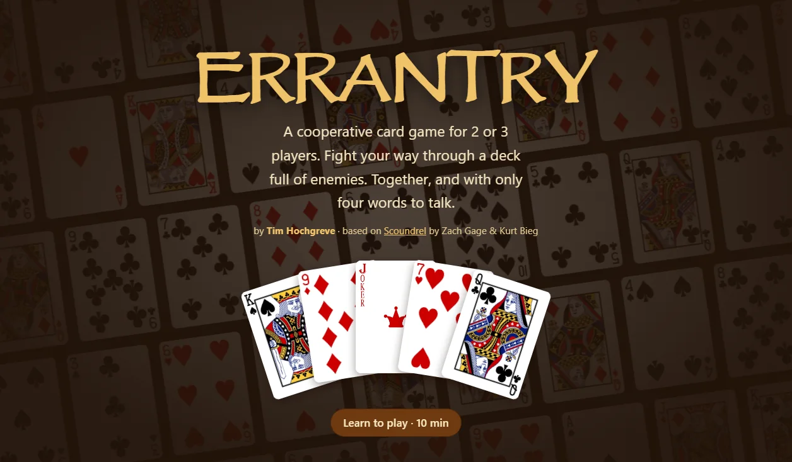
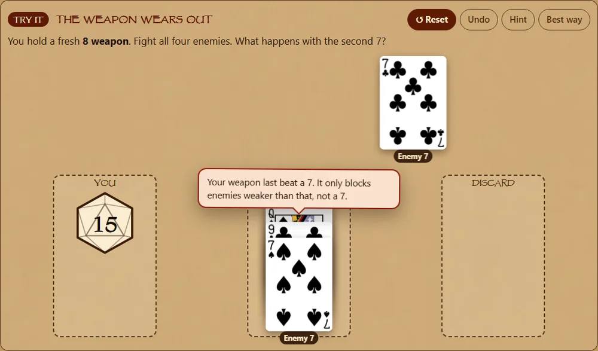
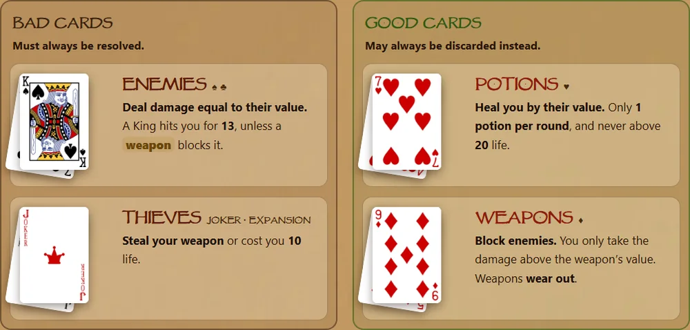
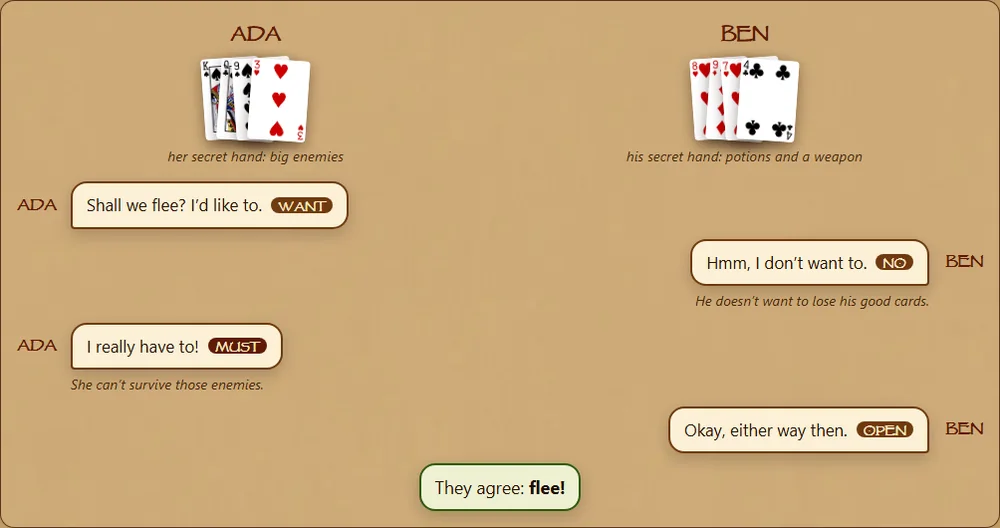
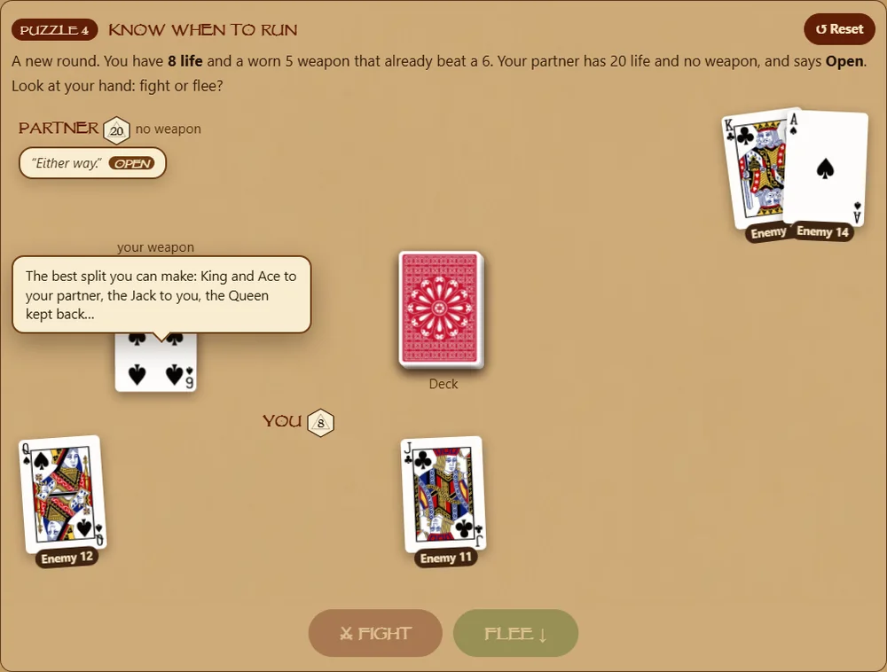
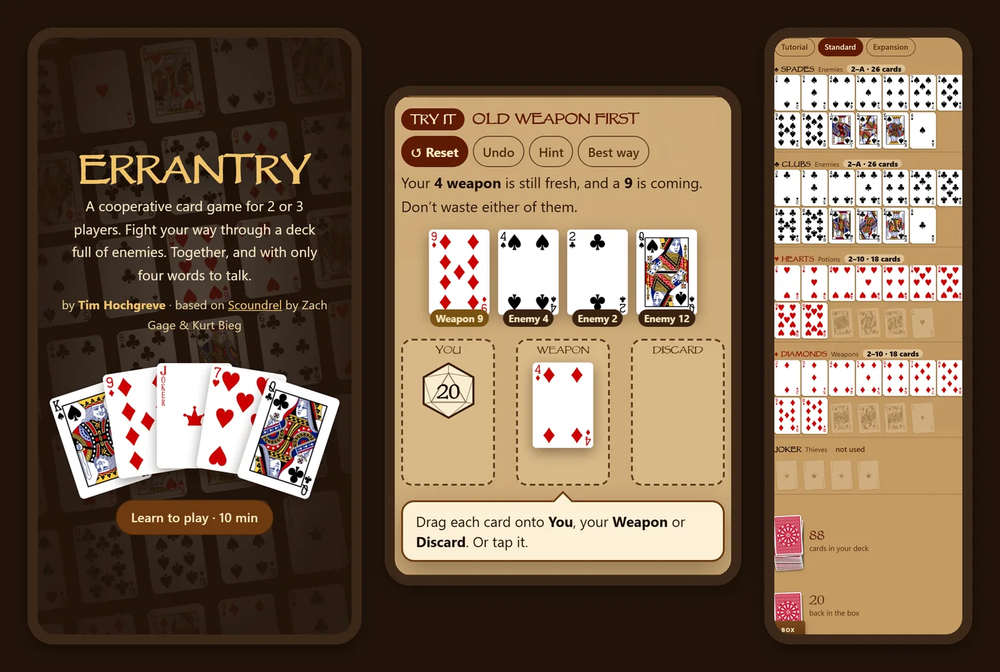
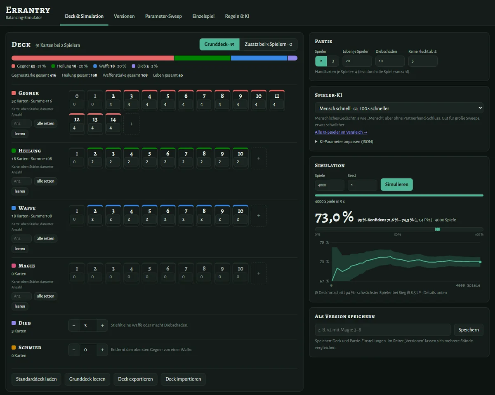
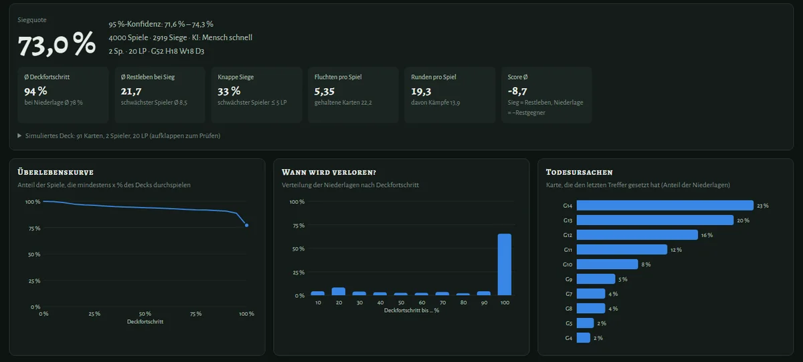
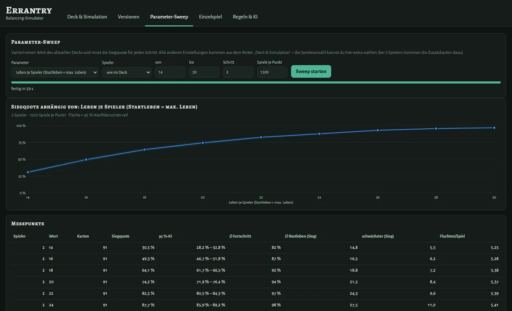

<p align="center">
  
</p>

<h1 align="center">Errantry</h1>

<p align="center">
  <b>A cooperative card game for 2 or 3 players.</b><br>
  Fight your way through a deck full of enemies – with two ordinary decks of cards and only four words to talk.<br>
  <sub>A game by <b>Tim Hochgreve</b> · based on <a href="http://stfj.net/art/2011/Scoundrel.pdf">Scoundrel</a> by Zach Gage &amp; Kurt Bieg</sub>
</p>

<p align="center">
  <a href="#-rules-website"><b>📖 Rules website</b></a> &nbsp;·&nbsp;
  <a href="#-balancing-simulator"><b>🎲 Balancing simulator</b></a> &nbsp;·&nbsp;
  <a href="#repository-layout"><b>🗂 Repository</b></a>
</p>

---

## The game in 30 seconds

| | |
|---|---|
| **Cards** | ♠ ♣ are **enemies**, ♥ **potions**, ♦ **weapons**, jokers **thieves** (expansion). J 11 · Q 12 · K 13 · A 14 |
| **Goal** | Play through the whole deck together. If anyone drops to 0 life, everyone loses. |
| **A round** | Refill your hand → flee? → who starts? → play cards to any player → everyone resolves their cards in any order |
| **The twist** | Weapons wear out and only block weaker enemies. You never show your cards – you only talk with *No · Open · Want · Must*. |

---

## 📖 Rules website

**Learn Errantry in 10 minutes and start playing.** Every rule comes with a picture or a little table you can try out: drag cards, see what happens, reset and try again. English and German, works on phones, one single offline HTML file.

<p align="center">
  
</p>

<p align="center">
  <br>
  <sub><b>The four kinds of cards</b> – bad cards must be resolved, good cards may be discarded.</sub>
</p>

<table>
  <tr>
    <td width="50%"><br><sub><b>Talking</b> – how a negotiation with only four words sounds.</sub></td>
    <td width="50%"><br><sub><b>Practice puzzles</b> – find the best order, or know when to run.</sub></td>
  </tr>
</table>

<p align="center">
  <br>
  <sub>Made for phones as much as for desktops.</sub>
</p>

**Open it:** [`website/dist/index.html`](website/dist/index.html) – double-click, no internet needed.

| Task | How |
|---|---|
| Edit | change files in `website/src/` (`index.html`, `style.css`, `js/`), then `npm run build:website` |
| Test | `website/test/` checks the page's rules against the simulator engine (20 000 random piles) and every puzzle's best result |
| Publish | only `website/dist/` goes online, e.g. as nginx `root` – after `git pull` the page is up to date |
| Translate | every text exists twice (`class="en"` / `class="de"`); scripts use `T('English', 'Deutsch')` |

---

## 🎲 Balancing simulator

**Thousands of games per second with a trained AI** – to balance decks, life and player count. Change the deck, press *Simulieren*, and see the win rate with confidence interval, survival curve, causes of death and much more. *(The simulator's interface is in German.)*

<p align="center">
  
</p>

<table>
  <tr>
    <td width="50%"><br><sub><b>Results</b> – win rate, survival curve, when and to what you lose.</sub></td>
    <td width="50%"><br><sub><b>Parameter sweep</b> – vary one value (here: starting life) and watch the win rate.</sub></td>
  </tr>
</table>

**Open it:** [`simulation/errantry.html`](simulation/errantry.html) – runs offline and uses all CPU cores.

- **Simulation** – set up the deck, choose games and seed, run. Earlier runs can be shown for comparison.
- **Versions** – save deck setups and simulate several of them against each other, for 2 or 3 players.
- **Parameter sweep** – vary life, thief damage, the number of a card type … and plot the win rate.
- **Single game** – read one game turn by turn (same seed = same game as in the mass simulation).
- **AI players** – *Human* (default: human-like memory), *Expert* (reads the partner's signals) or *Fast*.

### Command line

Run everything from `simulation/`. With `cli/visible.js` every run opens its own window with a progress bar and ETA:

```
cd simulation
node cli/visible.js runs/x.out "Title" node cli/check.js --cfgs std2,std3 --set play=pimc
```

| Command | Purpose |
|---|---|
| `node cli/check.js --cfgs std2,std3,magic2 [--set play=pimc]` | check the trained AI on several configurations |
| `node cli/sim.js --games 5000 --policy fast` | detailed report for one configuration |
| `node cli/sim.js --log --seed 1 --game 3` | log a single game |
| `node cli/ab.js "base" "holdBad=1"` | compare variants on identical games |
| `node cli/evolve.js --cfgs train --gens 30` | train the AI further by evolution |
| `node cli/bake.js tuning/<champion>.json` | make a champion the default AI (`src/tuned.js`) |

Configuration names (`cli/configs.js`): `std2`, `std3`, `magic2`, `smith2`, `mix2`, `mix3`, `full2`, `full3`, `hp16`, `hp24`, the groups `train` and `all`, or a path to a JSON configuration.

**Inside:** `src/engine.js` rules and round flow · `src/ai.js` AI (exact resolving, planner, PIMC over the partner's hand, flee/start negotiation) · `src/tuned.js` trained weights · `src/stats.js` statistics · `src/config.js` card types and default deck.

---

## Repository layout

```
Errantry/
├─ website/            rules website
│  ├─ src/             source: index.html, style.css, js/, assets/
│  ├─ dist/index.html  built page (one file, the one you publish)
│  ├─ build.js · test/ · tools/
├─ simulation/         balancing simulator
│  ├─ src/ · ui/ · cli/ · tuning/ · runs/ · test/
│  ├─ build.js
│  └─ errantry.html    built simulator
├─ docs/               design notes and README images
└─ package.json
```

Build and test everything (Node.js ≥ 18, no dependencies):

```
npm run build    # simulation/errantry.html + website/dist/index.html
npm test         # engine rule tests + website ↔ engine cross-check
```

---

## Credits & licenses

- **Game:** Errantry by Tim Hochgreve, based on *Scoundrel* (2011) by Zach Gage and Kurt Bieg.
- **Card images:** public-domain (CC0) playing cards from [Wikimedia Commons](https://commons.wikimedia.org/wiki/Category:Public_domain_playing_cards).
- **Heading font:** VTC Goblin Hand by WolfBainX (V.T.C. Vigilante Typeface Corporation), "Distro-Ware" – license text in [`website/src/assets/VTCinfo.txt`](website/src/assets/VTCinfo.txt).
